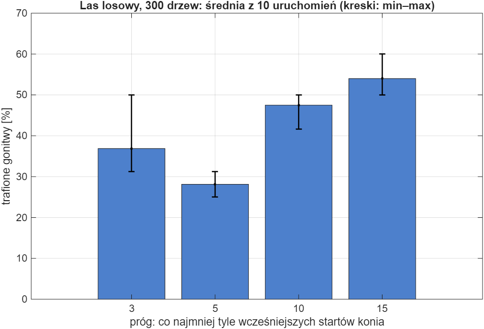
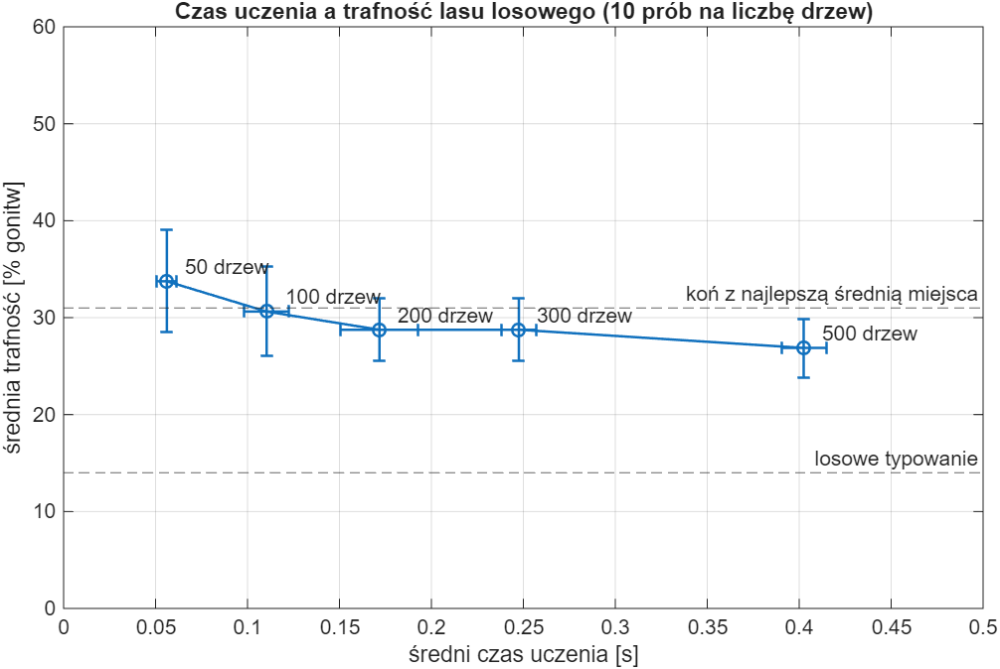

# Dziennik projektu

Model przewidujący zwycięzcę gonitwy na torze Partynice we Wrocławiu. Metody sztucznej inteligencji, II semestr
studiów magisterskich.

## Lab 1 – 7.10.2026: temat projektu

- Temat: model, który przed gonitwą szacuje szansę wygranej każdego konia i na tej podstawie typuje zwycięzcę.
  Dane z toru Partynice.
- Rozpoznanie źródeł danych: koniewyscigowe.pl (archiwum wyników do 2023 r.), torpartynice.pl (bieżący sezon),
  zbiory z Wielkiej Brytanii z Kaggle jako zapas.
- Narzędzie dowolne, prowadzący polecał Pythona i MATLAB-a.

## Lab 2 – 14.10.2026: przygotowanie bazy danych

**Przed zajęciami**

- Pobrane wyniki gonitw z Partynic z lat 2013–2023 (koniewyscigowe.pl) i z sezonu 2026 (torpartynice.pl) oraz
  całe kariery koni, które tam biegały, ze wszystkich torów (1998–2023).
- Baza w plikach CSV: `starty_partynice.csv` (1 wiersz = 1 koń w 1 gonitwie), `gonitwy_partynice.csv`
  (1 wiersz = 1 gonitwa), `program_2026_partynice.csv` (z programów PDF: numer startowy, dni od ostatniego startu,
  gwiazdki ★) i `historia_koni_PL.csv` (starty tych koni na wszystkich torach).
- Kontrola jakości (`kontrola_jakosci.txt`): jeden zwycięzca w gonitwie, brakujące miejsca, duplikaty, spójność
  identyfikatorów koni, wiarygodność czasów.

**Na zajęciach**

- Wybrane modele: regresja logistyczna i las losowy.

**Uwagi prowadzącego** (`TO DO .txt`)

- Tylko konie z Polski, więc zbiory z Wielkiej Brytanii zostały odłożone.
- Wybrać konie z największą liczbą startów.
- EDA z dużą liczbą wykresów: liczba startów na konia, okres startów, histogramy miejsc, stan toru w kolejnych
  latach.
- Okno przeszłości konia (3 lata, 100 startów albo pół sezonu) i statystyka z tego okna (średnia, mediana,
  dominanta).

**Po zajęciach**

- Ujednolicony zapis: kodowanie znaków, nazwy koni i osób, scalone identyfikatory tej samej osoby zapisanej
  na różne sposoby.
- Pogoda z IMGW (stacja Wrocław-Strachowice) dla każdego dnia wyścigowego. Zgodność z temperaturą podawaną
  przez tor: r = 0,96.
- Opis bazy: `README.md`, `SLOWNIK.md` (kolumny, typy, co jest znane przed startem, znane braki) i `ZRODLA.md`.
- Repozytorium na GitHubie.

**Ograniczenia bazy**: w obu źródłach brakuje lat 2024–2025, a kursów totalizatora nie podaje żadne źródło.
W 2026 r. punktem odniesienia mogą być gwiazdki ★ z programów.

## Lab 3 – 28.10.2026: wizualizacje (EDA)

**Przed zajęciami**

- Poprawki bazy: usunięte duplikaty startów w historii koni, odpięte starty „imienników” (koń miałby wtedy ponad
  20 lat) i wyczyszczony sprzeczny stan toru z 8.07.2020. Opis w `SLOWNIK.md`, w części „Znane braki”.
- Skrypty MATLAB-a w `eda/` i 13 wykresów w `eda/wykresy/`.
- Prezentacja z wykresami.

**Wnioski z danych**

- Połowa koni ma najwyżej 6 startów, typowa kariera trwa krócej niż rok, a koń startuje mniej więcej co 3 tygodnie.
- Najczęściej w gonitwie biegnie 7 koni. Do porównań lepsze jest miejsce względne (0 = zwycięzca, 1 = ostatni).
- Stan toru wyraźnie zmienia się z roku na rok. Pomiar toru skacze w 2016 r., a jesienią tor jest bardziej miękki.
- Okno przeszłości: pół sezonu (105 dni) zostawia 31% startów bez historii konia, 3 lata to prawie cała historia,
  a 100 startów to cała historia.
- Punkt odniesienia: koń z najlepszą średnią albo medianą miejsca z przeszłości wygrywa w ok. 30% gonitw,
  a losowe typowanie trafia w 13,2%.
- Sezon 2026: przez lukę 2024–2025 historię konia sprzed 2026 r. ma tylko 110 z 515 startów.

**Na zajęciach**

- Dziennik projektowy: co tydzień zapisujemy, co zostało zrobione, i wyniki (zrzuty ekranu, wykresy).
- Podział na zbiór treningowy i testowy 80/20, robiony raz, zaraz po przetwarzaniu wstępnym. Wszystkie modele
  i ich parametry porównujemy na tych samych zbiorach.
- Najpierw model z domyślnymi parametrami, potem sprawdzamy, jak działają zmiany parametrów.
- Co obserwować: jak zmienia się błąd w kolejnych iteracjach, czas uczenia w porównaniu ze skutecznością, trafność
  i krzywą uczenia, RMSE, R² i MAE przy regresji, ważność cech w lesie losowym.
- Pojęcia: epoka to jedno przejście przez cały zbiór uczący, a paczka (batch) to część epoki.

**Ustalenia**

- Na początek tor we Wrocławiu i sezon 2013.
- Bierzemy konie doświadczone (np. co najmniej 10 wcześniejszych startów). Konie z mniejszą liczbą startów usuwamy
  z gonitwy i sprawdzamy, który z doświadczonych wygra.
- Cechy to statystyki konia z przeszłości, np. mediana miejsc.
- Podział w obrębie sezonu: 3/4 sezonu trening, 1/4 test. Druga możliwość: okresy trzyletnie, w których trzeci rok
  jest testem.
- Podział pracy: las losowy (MATLAB) – Kasia, regresja logistyczna – kolega.

**Po zajęciach**

- Tabela do modelu `model/cechy_partynice.csv`: 1 wiersz = 1 koń w 1 gonitwie (2013–2023 i 2026, bez kłusaków),
  cechy konia liczone tylko ze startów sprzed danej gonitwy. Cel to kolumna `wygral`, a kolumna `zbior_2013` dzieli
  sezon 2013 na trening (gonitwy do 22.09.2013, 61 gonitw) i test (19 gonitw).
- Sprawdzenie progu doświadczenia: w 2013 r. przy progu 10 startów zostaje tylko 27 gonitw z co najmniej dwoma takimi
  końmi, a w co trzeciej z nich wygrał koń mniej doświadczony. Do rozważenia niższy próg (3–5 startów) albo więcej
  sezonów.

**Na zajęciach: pierwszy model – las losowy (Kasia, MATLAB)**

- `TreeBagger`: 300 drzew, `MinLeafSize` 5, 14 cech z tabeli (m.in. liczba startów, odsetek wygranych i miejsc
  w pierwszej trójce, średnia i mediana miejsca względnego, dni od ostatniego startu, dystans, liczba koni, wiek,
  waga). Uczenie i test na podziale `zbior_2013`.
- Las daje każdemu koniowi szansę wygranej, a typem w gonitwie jest koń z największą szansą. Miarą jest odsetek
  trafionych gonitw.
- Wyniki dla różnych progów doświadczenia (konie z mniejszą liczbą wcześniejszych startów usunięte):

  | Próg startów | Gonitwy testowe | Koni na gonitwę | Las losowy | Losowe typowanie | Koń z najlepszą średnią miejsca |
  |---|---|---|---|---|---|
  | 3  | 16 | 7,5 | ok. 31% | 12% | 38% |
  | 5  | 16 | 6,1 | 50% | 14% | 31% |
  | 10 | 12 | 2,9 | 50% | 19% | 42% |
  | 15 | 10 | 2,5 | ok. 31% | 21% | 50% |

- Wniosek: las wygrywa z prostą regułą przy progach 5 i 10, a przegrywa przy 3 i 15. Gonitw testowych jest jednak
  tylko 10–16, więc jedna gonitwa zmienia wynik o 6–10 punktów procentowych i różnice są w granicach przypadku.
  Wyników dla różnych progów nie można też porównywać między sobą, bo każdy próg daje inny zbiór testowy.
- Obserwacje: kolejne uruchomienia zmieniają ważność cech, ale nie odsetek trafień (przy kilkunastu gonitwach
  wynik zmienia się skokowo), dlatego ustawiamy stałe ziarno losowania `rng(1)`.
- Następny krok: więcej danych w teście, czyli okresy trzyletnie (np. uczenie 2013–2014 = 175 gonitw, test 2015 = 103
  gonitwy) i te same zbiory dla regresji logistycznej.

## 12.11.2026: powtarzalność lasu i liczba drzew

- Las z 28.10 puszczony 10 razy na każdy próg (różne losowanie, `model/trafnosc_progi.m`). Średnia trafność:
  próg 3 – 37%, 5 – 28%, 10 – 48%, 15 – 54%. Pojedyncze wyniki z 28.10 (50% przy 5, 31% przy 15) to w dużej części przypadek: przy 10–16 gonitwach
  testowych wynik zależy od losowania.
  
- Czas uczenia a trafność (`model/czas_vs_trafnosc.m`, próg 5, 10 prób na każdą liczbę drzew):

  | Drzewa | Czas uczenia | Trafność (min–max) |
  |---|---|---|
  | 50  | 0,05 s | 34% (25–44%) |
  | 100 | 0,10 s | 31% (25–38%) |
  | 200 | 0,18 s | 29% (25–31%) |
  | 300 | 0,24 s | 29% (25–31%) |
  | 500 | 0,40 s | 27% (25–31%) |

- Wniosek: czas rośnie proporcjonalnie do liczby drzew, trafność nie rośnie. Więcej drzew daje stabilniejszy wynik
  (mniejszy rozrzut), a nie lepszy. Wyniki porównujemy jako średnią z kilku uruchomień, nie z jednego.

  
- Kody lasu w `model/`: `test1.m` (pierwszy las), `trafnosc_progi.m`, `czas_vs_trafnosc.m`; tabelę cech buduje
  `model/zbuduj_cechy.py`.

## Lab 4 – 13.11.2026: dobór cech i plan porównania modeli

**Na zajęciach**

- Cech ma być jak najmniej. Nowe cechy można tworzyć z już znanych (ekstrakcja, np. statystyki konia). Przy
  selekcji odrzuca się cechy, które niosą tę samą informację (skorelowane), i cechy o małej wariancji, bo niczego
  nie rozróżniają.
- Redukcja wymiarowości: PCA tworzy nowe cechy jako kombinacje starych, uporządkowane od największej wariancji.
  Zostawia się kilka pierwszych, które niosą większość informacji.
- Setki uruchomień najlepiej liczyć w chmurze (Google Colab, Kaggle, MATLAB Online, AWS, Azure, GCP).
- W tabeli cech przygotowany podział trzyletni `zbior_3lata`: trening 2013–2014 (175 gonitw), test 2015
  (103 gonitwy).
- Kacper: regresja logistyczna (`KONIKI.m`) na tych samych 14 cechach i podziałach co las.

**Ustalenia z prowadzącym**

- Sprawdzić, ile koni zostaje w gonitwie przy kolejnych progach doświadczenia.
- Każdy sezon osobno: czy model radzi sobie podobnie w każdym sezonie.
- Las losowy na 50 i na 100 drzewach, osobno.
- Skuteczność w kolejnych sezonach: porównanie lasu i regresji, z odchyleniem standardowym i inną statystyką.

**Po zajęciach**

- 25.11: liczba koni przy progach. Nad słupkami wykresu trafności lasu jest liczba gonitw testowych i średnia liczba
  koni w gonitwie. Przy progu 3 w gonitwie testowej startuje średnio 7,5 konia, a przy progu 15 tylko 2,5. Mniej koni
  to łatwiejsze typowanie: losowy typ trafia przy progu 3 w 12,5% gonitw, a przy progu 15 w 20,8%.

  

## Lab 5 – 25.11.2026: walidacja i plan optymalizacji hiperparametrów

**Przed zajęciami: każdy sezon osobno** (ustalenie z 13.11)

- W każdym sezonie 2013–2023 ten sam podział co w 2013: pierwsze 3/4 gonitw sezonu to trening, ostatnia 1/4 to test
  (kolumna `zbior_sezon`). Próg: co najmniej 3 wcześniejsze starty konia.
- Las losowy na 50 i na 100 drzewach, 10 uruchomień w każdym sezonie: średnio 33,6% i 33,9% trafionych gonitw, losowe
  typowanie 13,6%. Odchylenie standardowe między sezonami wynosi 10–11 punktów procentowych, a między uruchomieniami
  w jednym sezonie średnio 5,2 (50 drzew) i 4,6 (100 drzew).
- Najwyższy wynik daje 2016 r. (las 59–62%). W teście z 2016 r. częściej wygrywali faworyci: koń z najlepszą średnią
  miejsca wygrał w 47% gonitw testowych, a w pozostałych sezonach w 21–37,5%. Test to tylko 17 gonitw z trzech
  niedziel, więc kilka przewidywalnych dni podnosi wynik całego sezonu.
- Porównanie z regresją logistyczną (Kacper) na tych samych gonitwach testowych, średnia z 11 sezonów (las: 50 drzew,
  5 uruchomień):

  | Próg startów | Regresja logistyczna | Las losowy | Koń z najlepszą średnią miejsca | Losowe typowanie |
  |---|---|---|---|---|
  | 3 | 28,2% | 34,3% | 31,9% | 13,6% |
  | 5 | 30,8% | 30,8% | 31,5% | 14,6% |

- Przy progu 3 las jest lepszy od prostej reguły w 8 z 11 sezonów, średnio o 2,4 punktu procentowego, ale test t dla
  par daje p = 0,15, więc różnica mieści się w granicach przypadku. Regresja jest średnio o 3,7 punktu gorsza od reguły
  (p = 0,18). Przy progu 5 wszystkie trzy metody trafiają praktycznie tyle samo.
- Remis kilku koni z tą samą oceną liczymy jako szansę 1/k. Wcześniej kod brał pierwszy wiersz gonitwy, a w tabeli
  zwycięzca stoi pierwszy, więc przy remisie typ zawsze trafiał (jeden taki przypadek w regule, 2014 r.).

**Na zajęciach: walidacja**

- Błędy walidacji: wyciek danych, gdy model ma bezpośredni lub pośredni dostęp do danych testowych (np. PCA liczone
  na całych danych), dlatego przetwarzanie danych robimy tylko na zbiorze treningowym. Drugi błąd to wniosek
  z pojedynczego uczenia, bo jego wynik może być przypadkowy (zależy od modelu i danych).
- Ocena stabilności: N trenowań na tych samych danych i z tymi samymi ustawieniami oraz M trenowań na innych podziałach
  80/20. Wynik podajemy jako średnią ± odchylenie standardowe; można też zrobić M×N trenowań. Trzeba wiedzieć, kiedy
  ziarno losowania (seed) ma być stałe, a kiedy trzeba je zmieniać.
- Walidacja krzyżowa, szybsza przy dużych N×M: dane dzielimy na k równych części i robimy k treningów na k−1 częściach,
  za każdym razem z inną częścią jako zbiorem testowym. Zwykle k = 5–10, np. przy k = 5 pierwszy przebieg testuje
  na K1 i uczy się na K2–K5 itd. Stosuje się też zagnieżdżoną walidację krzyżową.

**Ustalenia (do zrobienia)**

- Sprawdzić N i M trenowaniami, czy nie ma wycieku danych i czy model jest stabilny. Stabilność jest w porządku.
- Early stopping: przerwać trening, gdy model jest optymalny, a kolejne przebiegi nie dają dużego przyrostu
  skuteczności.
- Optymalizacja hiperparametrów: znaleźć najlepszą liczbę drzew (10, 50, 200), część sezonu przeznaczoną na trening
  (czy inny stosunek niż 80/20 będzie lepszy) i liczbę poprzednich lat branych do treningu. Metody: grid search
  (sprawdza wszystkie kombinacje parametrów; opisać, jak działa), coarse to fine (najpierw rzadka siatka, potem
  gęstsza wokół najlepszego wyniku) i random search (losuje kombinacje).
- Porównać, o ile szybszy jest random search od grid search i jak wypadają jego wyniki.
- Rozważyć inny model.
- Przy ocenie modeli podawać średnią trafność i średnie odchylenie standardowe, także dla lasu w każdym sezonie osobno.
